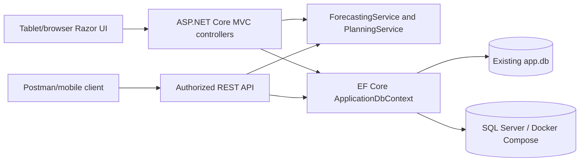

# Architecture and source map

`Program.cs` selects SQLite by default and SQL Server when `DatabaseProvider=SqlServer`. `DbInitializer` preserves SQLite data with `EnsureCreated` plus idempotent indexes, and uses the EF migration history for SQL Server. Domain rules live in `Models`, persistence in `Data`, business calculations in `Services`, and transport validation in `Models/ApiDtos.cs`.
